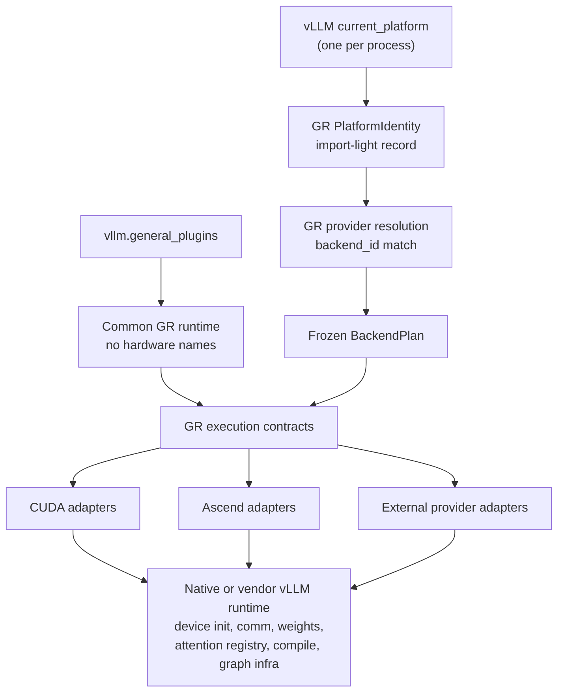
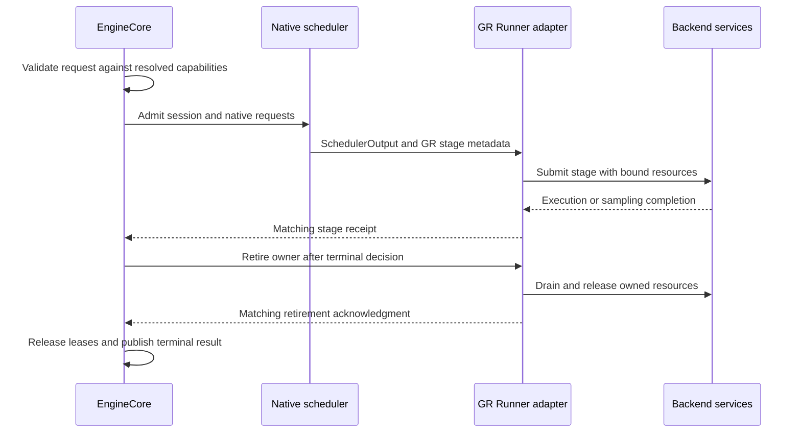

# Multi-hardware backend design

## Decision and scope

Reuse vLLM's platform discovery rather than building a second hardware discovery
system, and keep a thin GR-specific provider on top of the platform vLLM has
already selected.

vLLM selects the hardware platform and owns the vendor runtime. vLLM-GR selects
an implementation of recommendation execution for that platform. Common request,
session, scheduling, scoring, and result semantics remain in GR core and contain
no hardware names.

There are two separate questions in "should GR have its own hardware plugin
system", and they have different answers:

| Question | Answer | Reason |
| --- | --- | --- |
| Should GR perform hardware discovery? | No | Upstream platform selection already resolves exactly one platform per process and rejects multiple active out-of-tree platform plugins. A second discovery would conflict with `vllm-ascend` on NPU and with native CUDA on GPU. |
| Should GR have its own provider registry? | Yes | Upstream `Platform` describes devices. It has no contract for GR sessions, stage dispatch, constrained candidate semantics, or graph ownership. |

So the target is not "a parallel plugin system". It is a narrow GR backend layer
whose key is a **backend identity derived from the already-selected platform**,
not a hardware probe of its own.

This is a proposed architecture and migration plan. The interfaces and
configuration additions below are not implemented by this document. CUDA and
Ascend are the first migration targets. ROCm and XPU illustrate future providers;
their presence in this design is not a claim of GR inference support.

The acceptance goal is concrete: adding a third hardware backend requires a
provider package, its adapters, and backend conformance evidence, without adding
hardware-name branches to shared GR scheduling, stage dispatch, or attention
dispatch. A new recommendation algorithm can still require a deliberate change
to the shared protocol.

One process retains one selected hardware backend. Multiple engines using that
backend may have independent configurations and resources within upstream
process-level constraints. Running one model across heterogeneous GPU/NPU
workers, changing platforms in a live process, expanding supported parallelism,
and changing Beam request semantics are outside this proposal.

## Current state audit

The provider boundary already exists in `vllm_gr/platforms/`, but production code
does not use most of it. Any migration plan that assumes the contract is live is
wrong, so the gap is recorded first.

The reviewed source is
[`fd0184b9`](https://github.com/JiusiServe/vllm-gr/tree/fd0184b9a0183752cf6fdcb6e5df72622f72e115).

### Registered entry points

`pyproject.toml` declares exactly one entry-point group:

```toml
[project.entry-points."vllm.general_plugins"]
vllm_gr = "vllm_gr.plugin:register"
```

There is no `vllm.platform_plugins` registration, which is correct: GR must not
attempt to become a platform. `platforms/loader.py` additionally reads the GR-only
group `vllm_gr.platform_backends`, whose entry-point name must equal
`provider.device_type`.

### The provider contract is declared but mostly unwired

`GRBackendProvider` has five required methods. Only one is called on a production
path:

| Provider method | Production caller | Status |
| --- | --- | --- |
| `create_constrained_topk_execution` | `constraints/startup.py:77` | Wired |
| `check_environment` | none | Unwired |
| `apply_runtime_patches` | none | Unwired |
| `get_model_runner_hooks` | none | Unwired |
| `get_attention_execution` | none | Unwired |

The replacements that run instead:

| Responsibility | Actual production path |
| --- | --- |
| Environment validation | `plugin.initialize_runtime()` calls `_env_check.check_environment()` directly; that function branches on `str(current_platform.device_type) == "npu"` (`_env_check.py:166-177`) |
| Compatibility patches | `patch._apply_patches()` calls `ascend_compat.*`, `npu_spawn_patch`, and `pangu_compat` directly (`patch.py:541-555`) |
| Runner selection | `model_runner_patch._active_platform_module_name()` reads `current_platform.device_type` and picks a module (`model_runner_patch.py:255-271`) |
| Attention selection | `beam_attn._get_platform_execution_module()` picks GPU, NPU cascade, or NPU xllm (`beam_attn.py:91-113`) |

A second reason the unwired getters cannot simply be plugged in is that neither
factory takes a plan or an owner. `get_model_runner_hooks()` and
`get_attention_execution()` import a module and `cast` it
(`platforms/cuda.py:39-49`), so a caller cannot bind the result to a specific
engine, and the `cast` itself proves nothing about conformance. Returning a module
is acceptable; returning an unbound one is not. See
[Protocol conformance is structural](#protocol-conformance-is-structural).

### Hardware-name branches in shared layers

These are the places that must disappear from shared dispatch. Counts are lines
containing a hardware predicate or device-type comparison.

| Location | What it decides |
| --- | --- |
| `v1/attention/backends/beam_attn.py` | 32 lines reference module-level `NPU_DEVICE` / `CUDA_DEVICE`; also a process-global attention-mode cache |
| `v1/worker/gr_execution.py:94,106,123,128` | Stage runner and retirement selection by `str(worker.device).split(":")[0]` |
| `v1/worker/gr_startup.py:64-69` | Beam graph capture selection |
| `v1/worker/prefill_graph_runner.py:54` | Prefill graph runner class selection |
| `v1/attention/backends/beam_attn_metadata.py:344-346` | Caches `_is_cuda` / `_is_npu` from `device.type` |
| `v1/beam/beam_decision.py:108,600,635,647,695` | Decision and operator-path selection |
| `engine/arg_utils_gr.py:355,383,392` | Default pinning for NPU/CUDA |
| `entrypoints/beam_search_v1/input_processor.py:177-181` | Constraint table backend default |
| `v1/npu_kv_layout.py:200` | KV layout policy gate |
| `v1/ascend_compat.py:35` | Platform predicate |
| `constraints/startup.py:111` | Vocabulary slicing is CUDA-only |
| `constraints/loader.py:595,605,621,631,652` and `v1/worker/model_runner_patch.py:141,171,194` | `ConstraintTableBackendEnum` used as a behavior selector (CUDA slice versus NPU stage vocabulary) |

Two of these deserve emphasis because they are not just missing abstraction:

1. `beam_attn.py:42-43` evaluates `is_npu_available()` / `is_cuda_available()` at
   **module import**. The CUSTOM attention backend is a single process-global
   registry slot (GR-PATCH-013), so platform identity is effectively frozen at
   import time.
2. `beam_attn.py:45-88` keeps `_NPU_DECODE_EXECUTION_MODE` as a process-global
   cache, which already violates this proposal's own "no process-global per-engine
   attention mode" rule. It must be retired as part of the attention stage, not
   inherited by the new interface.

Moving dispatch alone therefore does not finish the abstraction. The larger
defect is that the contract is not **assembled into the runtime** at all.

## Relationship to native vLLM

Use `vllm.general_plugins` to load GR in each participating process. Continue
using native CUDA support and the vendor's `vllm.platform_plugins` package for
Ascend or other out-of-tree hardware. Reuse upstream device initialization,
communicators, model loading, attention registration, and compilation facilities
where the selected backend supports them.

Do not register a second GR platform alongside the vendor platform. Upstream
platform selection chooses one platform and rejects multiple active out-of-tree
platform plugins. A GR backend augments that selection; it does not perform a
second hardware discovery or replace `current_platform`.

Subclassing the vendor `Platform` class and re-registering it is also rejected.
Upstream `Platform` exposes several dozen overridable methods whose meaning is
device and runtime, not GR session or stage semantics; a GR subclass would have to
inherit the vendor subclass, producing MRO conflicts and a per-upgrade coupling to
every vendor method, in exchange for nothing that the GR provider does not already
provide.



The branches are alternatives. The diagram does not imply heterogeneous execution
inside one engine.

### Alternatives considered

| Option | Assessment |
| --- | --- |
| Use only upstream Platform methods | Reuses discovery, but has no contract for GR stages, constraints and graph ownership |
| Register a GR subclass of the vendor Platform | Conflicts with the one-platform rule, inherits the entire vendor method surface, breaks on vendor upgrades |
| Build a separate hardware framework | Duplicates platform/runtime responsibilities and increases conflicts with vendor plugins |
| Native platform plus a thin GR provider | Selected: reuse the upstream runtime and define only GR-specific execution boundaries |

The selected option still requires compatibility work when upstream Runner APIs
change. A provider API does not make those private upstream APIs stable; it keeps
their adaptation in one owner instead of spreading it through shared GR code.

## Backend identity and deterministic selection

`device_type` identifies tensor placement, not a unique hardware implementation.
AMD ROCm's `RocmPlatform.device_type` is also `"cuda"` (see the upstream reference
in [References](#references)). Resolving every `"cuda"` device to the NVIDIA
provider would select incompatible kernels.

Introduce a distinct `backend_id`, using `cuda` and `ascend` for the initial
providers. Represent the already-selected upstream platform with an immutable,
import-light `PlatformIdentity`:

- Upstream platform enum value, read from the live `current_platform`.
- Tensor `device_type`.
- Platform class qualified name, built from `type(current_platform)`.

Class lineage allows a vendor-specific subclass to be recognized without importing
every vendor runtime, because `current_platform` is already an instance: reading
`type()` and `__module__` costs no import and keeps the existing
`tests/platforms/test_import_isolation.py` guarantee. Out-of-tree providers must
match an explicit vendor identity; the generic `OOT` enum or a shared tensor device
type is insufficient. Unknown subclasses are rejected unless explicitly supported.

| Upstream platform | Tensor device type | GR backend ID | Matching requirement |
| --- | --- | --- | --- |
| NVIDIA CUDA | `cuda` | `cuda` | Native CUDA identity; not merely `device_type == "cuda"` |
| Ascend NPU | `npu` | `ascend` | Supported Ascend Platform identity and `npu` placement |
| AMD ROCm | `cuda` | `rocm` | Native ROCm identity; future provider |
| Intel XPU | `xpu` | `xpu` | Native XPU identity; future provider |

Resolution follows this order:

1. Register built-ins and discover external provider objects. Validate every
   provider's metadata and API version before committing registry changes.
2. Obtain `PlatformIdentity` from vLLM. Never infer selection from installed
   packages or simultaneous `torch.*.is_available()` results.
3. If `backend.id` is explicit, require that provider to match the upstream
   identity. An explicit ID does not switch the vLLM platform.
4. Otherwise require exactly one matching provider. Zero matches is unsupported;
   multiple matches is ambiguous. Do not use discovery order or priority scores.
5. Check provider API compatibility, installed runtime versions, and selected
   feature requirements before exposing the GR engine as ready.

Duplicate backend IDs from different providers are errors, including duplicates
between built-ins and external packages. Today
`registry._validate_backend_registration()` enforces this for `device_type`
duplicates, and `tests/platforms/test_plugin_loader.py` pins it.

Installing an external Ascend provider therefore conflicts with the built-in by
construction. Removing the built-in implicitly is not acceptable, because a
package upgrade could silently change which implementation runs. Use an explicit,
documented distribution switch instead:

- Built-ins load first from their own internal registration path
  (`platforms/builtins.py`), external providers load second.
- An external provider for an ID already claimed by a built-in is a hard error
  unless a documented environment switch disables that built-in ID, for example
  `VLLM_GR_DISABLE_BUILTIN_BACKENDS=ascend`.
- Diagnostics must name both sources and the switch that suppressed the built-in.

Third-party IDs should use a vendor prefix when they are not the canonical
implementation. Explicit selection may resolve overlapping platform matches, but
must never suppress duplicate IDs or select an incompatible platform.

## Provider contract

Introduce an API version, keep the provider small, and compose separate execution
services instead of a large abstract base class with many optional callbacks. Every
factory receives its plan and its lifecycle owner, and no factory reads a hidden
current plan.

The current method set is **not** retained unchanged. Four signatures change, and
the migration must say so rather than implying a compatible extension:

| Current method | Proposed method | Change |
| --- | --- | --- |
| `device_type: str` | `backend_id: str` | Identity is no longer tensor placement |
| (absent) | `api_version: int` | Explicit version, never inferred |
| (absent) | `matches(identity)` | Replaces `device_type` equality |
| (absent) | `resolve(request) -> BackendPlan` | New admission boundary |
| `check_environment()` | `check_environment(context)` | Gains process role and runtime context |
| `apply_runtime_patches()` | `install_process_hooks(context)` | Renamed; returns a report, not a count |
| `get_model_runner_hooks()` | `create_model_runner_adapter(*, plan, native_runner)` | Becomes a bound factory |
| `get_attention_execution()` | `create_attention_executor(*, plan, device)` | Becomes a bound factory |
| `create_constrained_topk_execution(device=...)` | `create_constrained_topk_execution(*, plan, device)` | Gains the plan |

```python
from typing import Protocol


class GRBackendProvider(Protocol):
    backend_id: str          # "cuda" | "ascend" | vendor-prefixed
    api_version: int         # 2

    def matches(self, identity: "PlatformIdentity") -> bool: ...

    def resolve(self, request: "BackendRequest") -> "BackendPlan": ...

    def check_environment(self, context: "ProcessContext") -> "RuntimeReport": ...

    def install_process_hooks(self, context: "ProcessContext") -> "HookReport": ...

    def create_model_runner_adapter(
        self, *, plan: "BackendPlan", native_runner: object
    ) -> "ModelRunnerAdapter": ...

    def create_attention_executor(
        self, *, plan: "BackendPlan", device: "Device"
    ) -> "AttentionExecutor": ...

    def create_constrained_topk_execution(
        self, *, plan: "BackendPlan", device: "Device"
    ) -> "ConstrainedTopKExecution | None": ...
```

These are proposed signatures, not an existing importable API. The concrete native
runner type stays inside the backend adapter.

Stage and graph services are composed behind the selected runner adapter in the
first implementation. They get independent provider factories only when real
callers justify them; until then, adding factories would repeat the earlier
mistake of designing interfaces with no consumer.

### Protocol conformance is structural

Python modules can implement a `Protocol` when their exported members have
compatible signatures. Therefore:

- A module-returning getter is not inherently invalid. The existing
  `beam_attn_gpu.py` and `beam_attn_npu.py` modules are legitimate implementations
  of the attention contract.
- `cast` proves nothing and is not evidence of conformance.
- Conformance is validated by checking required members, their signatures, and
  their behavior, not by banning modules categorically.
- Keep stateless module implementations where they fit. Introduce bound adapter
  objects only where plan binding, state ownership, or lifecycle adaptation
  requires them.

The earlier revision of this document described module returns as a structural
defect and required adapter objects everywhere. That was wrong. The real defect in
`get_model_runner_hooks()` and `get_attention_execution()` is narrower: they take
no plan and have no owner, so a caller cannot bind them to a specific engine. The
fix is the factory signature above, not a blanket ban on modules.

`GRBackendRuntime` and `RunnerContext` are not required for the first
implementation. Removing them must not remove the explicit path by which every
service receives its engine plan and lifecycle owner.

### Deferred contracts

These are recorded so the migration does not have to redesign them later, but
they are not part of API version 2:

| Deferred concept | Why deferred |
| --- | --- |
| `GRBackendRuntime` | Runner ownership is already expressed by the native runner lifecycle plus plan invalidation |
| `RunnerContext` | Only needed once two backends share one runtime factory shape |
| Per-service factory negotiation | The five services below have distinct shapes; a generic factory hides that |

### Execution services

| Service | Contract boundary | Initial implementations |
| --- | --- | --- |
| Runner adapter | Attach to the selected native lifecycle, translate inputs/outputs, preserve native fallback | CUDA V1, CUDA V2, Ascend runner |
| Stage executor | Execute and sample GR stages; preserve error propagation and retirement acknowledgments | Existing GPU/NPU stage runners |
| Attention executor | Prepare device metadata, write KV, run Prefill/Decode using shared logical Beam metadata | CUDA, Ascend cascade/xllm with separate Prefill handling |
| Graph executor | Validate capture shapes, capture/replay, report actual execution, invalidate and close | CUDA Graph and Ascend ACL Graph adapters |
| Constraint execution | Preserve canonical tokens, scores, validity and resource identity | Existing constrained Top-K implementations |

Runner translation may need both `execute_model` and `sample_tokens`; do not
collapse the native asynchronous lifecycle into a synchronous `run()` call.
Factories receive the same resolved plan so they cannot independently choose
incompatible KV layouts or graph modes.

State ownership is fixed:

- Process: provider registry, selected platform/backend identity, verified hook
  installation records. No process-global per-engine attention-mode cache.
- Engine: normalized configuration, immutable plan and admitted capabilities.
- Runner: model-bound buffers, graph executors, constraint instances, streams,
  events, and workspace. Different runners never share mutable execution state.
- Session: dispatch/generation identities and leases governed by the existing
  session contract. Backend code cannot release native KV independently.

Settings that upstream vLLM treats as process-global remain process-global. If a
second engine requests an incompatible native runner setting or class-patch
variant, reject it with a separate-process requirement rather than mutating the
first engine's behavior.

Prefer composition. Existing `make_patched_*` factories may remain inside the
adapters during migration. Their upstream private method names are not the
external provider API. Do not require all future backends to emulate CUDA V1's
`_prepare_inputs` or `_bookkeeping_sync` methods.

### Provider API version 1 compatibility

`vllm_gr.platform_backends` already has objects that are not versioned. Detect
them explicitly and never by duck typing:

- Read `getattr(provider, "api_version", 1)`.
- A version-1 object is mapped through a narrow adapter that requires an exact
  `device_type` match and applies the fixed aliases `cuda` to NVIDIA CUDA and
  `npu` to Ascend. It emits a deprecation warning naming the distribution.
- A version-1 object is never upgraded in place, and its previously optional
  attributes are never read as evidence of version-2 capability.
- Explicit backend identity for an arbitrary version-1 third-party `device_type`
  requires an explicit identity upgrade; there is no inference.

## Capabilities, configuration, and readiness

Capabilities describe valid combinations, not independent feature booleans. For
example, support for an NPU graph mode may depend on xllm execution, dtype, KV
layout, Beam widths, and logical batch size simultaneously.

The plan must capture or validate these dimensions:

- Native runner family/version and upstream interface compatibility.
- Model architecture, dtype, attention geometry, KV dtype/layout and block size.
- Prefill and Decode attention implementations independently.
- Constraint mode, vocabulary slicing, artifact compatibility and Top-K bounds.
- Logical batch sizes, physical row limits, fixed/dynamic Beam schedules,
  candidate widths, stage count and in-flight dispatch depth.
- Graph capture/replay policy, supported shapes and explicit eager fallback.
- Prefix caching, request mixing, chunking, and supported parallel topology.

Keep the current limits for each existing path until separate implementation and
validation expand them. A capability for CUDA V2 must not enable the same feature
on CUDA V1 or Ascend. The CPU selection oracle is not a production CPU backend.

### Plan representation and fingerprint

`resolve()` must return something hashable and comparable, because workers report
a fingerprint and the engine refuses to start on a mismatch.

- Each backend owns a frozen options dataclass and a declarative table of
  supported combinations. Validation is table lookup plus explicit rejects, not
  a chain of independent `if` statements.
- The fingerprint is a SHA-256 over the normalized plan fields **including the
  adapter package version**. Without the package version, a wheel upgrade with an
  unchanged configuration would silently reuse stale compatibility assumptions.
- `resolve()` must be pure and idempotent. `vllm_gr.plugin.register` runs again on
  every `EngineArgs` round-trip (`create_engine_config` re-asserts the entry
  point, GR-PATCH-019), so a stateful or mutating `resolve()` would corrupt the
  second call. Any memoization must be keyed by normalized input and must not
  survive a configuration change.

During engine configuration, `resolve()` validates known information and returns
a frozen plan. Workers then validate actual device/kernel availability and perform
allocation and warmup. Each worker reports readiness and the stable plan
fingerprint through startup control flow. The engine starts accepting GR requests
only after all required participants confirm compatible plans.

If a worker cannot satisfy the plan, startup fails. It must not independently
downgrade to another kernel or mode. Automatic choices are made once and recorded;
request-dependent graph/eager routing is permitted only within the resolved
policy. This does not introduce mixed-revision operation: the existing
same-revision deployment contract still applies.

Add an optional `backend` subtree under the existing
`VllmConfig.additional_config["vllm_gr"]` schema. Illustrative proposed input:

```json
{
  "vllm_gr": {
    "backend": {
      "id": "ascend",
      "options": {
        "decode_attention": "xllm"
      }
    }
  }
}
```

`id` defaults to `auto`; the selected provider validates its namespaced options.
Unknown option keys and options belonging to another backend are errors. Common
Beam parameters remain common rather than moving into opaque backend options.

Existing configuration continues to work:

| Existing setting | Migration rule |
| --- | --- |
| `VLLM_USE_V2_MODEL_RUNNER` | Preserve native selection/default policy and resolve the matching adapter |
| `npu_decode_execution` | Normalize into the selected Ascend option; preserve cascade/xllm defaults |
| `prefill_flash_attn_version` | Normalize into CUDA Prefill options; reject incompatible backends |
| Beam and Prefill graph settings/environment variables | Preserve the current path-specific precedence and capture policies |
| Constraint Table backend selector | Normalize as a constraint execution choice and validate against the selected hardware; do not use it for platform discovery |

If new and legacy settings explicitly disagree, reject the configuration rather
than choosing silently. Keep `beam.execution_mode="v1"` distinct from native
ModelRunner V1/V2. Parser cache invalidation and GR config serialization must be
updated with the owning configuration contract when these fields are implemented.

### Retiring the constraint backend enum

`ConstraintTableBackendEnum` (`config/models.py:46-51`) is currently both a report
field and a behavior selector: `model_runner_patch.py:171` chooses vocabulary
slicing for `CUDA`, and `:194` chooses stage vocabulary for `NPU`, while
`constraints/loader.py:595-652` selects the implementation.

Retire it in two steps rather than in one:

1. Each provider returns a stable `implementation_id: str` plus an optional
   `legacy_enum` for existing branches. New providers declare their supported
   implementation IDs; adding one must not require a new member in a core enum.
2. Only after step 1 is validated on both platforms, remove the behavior branches
   that consume the enum and reduce it to a historical payload identifier.

Doing both at once understates the work and risks changing constraint results
silently.

## Shared scheduling and backend execution

Keep the existing transport: `BeamBatchRequest`, native `SchedulerOutput` with GR
metadata, and `BeamBatchResult`. `BackendPlan` is startup configuration; it is not
a new per-step wire message or a frontend-driven execution loop.

GR core owns admission, session state, logical stage dependencies, completion,
failure, cancellation, and retirement. Native vLLM scheduling continues to own
prompt accounting, KV blocks and scheduled token counts. Backends consume the
resulting execution view and preserve its identities.

Backend-specific admission rules expose a pure shape/feature validation boundary.
They run before mutating session, native request, or KV state. Shared scheduling
may use declared capacities and restrictions, but does not inspect hardware names,
CUDA streams, or ACL graph objects. A fundamentally different scheduling algorithm
requires a separate scheduler-policy proposal; it must not be hidden inside a
provider callback.



The sequence shows logical dependencies, not a mandatory host synchronization
between every arrow. Preserve asynchronous overlap and current dispatch depth.
Backend completion must not be confused with successful kernel submission.

Common Beam semantics include item/member order, parent indices, global token
IDs, score normalization, structural validity, and terminal-result validation.
Devices may use different fused algorithms and physical representations. Compare
their results using the existing numerical and tie contracts rather than requiring
identical intermediate tensor layouts or arbitrary tied-slot order.

## Graph, attention, and resource lifecycle

Separate logical metadata from device metadata. Common code describes Beam
membership, prefix/suffix extents and parent relationships. The backend produces
its kernel layouts, masks, offsets and buffers. Upstream Attention registration
and backend selection remain in use where available.

Do not force generic attention interfaces to expose FlashAttention version numbers
or a method named `cascade_attention`. Such details belong in CUDA/Ascend adapters.
The first migration may wrap the existing modules; a later interface can expose
Prefill/Decode operations without those implementation-specific arguments.

### Attention stage work items

The attention migration has three parts, in this order:

1. Remove module-import-time platform constants from `beam_attn.py`. Constructing
   the execution module inside `BeamAttentionImpl.__init__` already happens
   (`beam_attn.py:208-212`), so the module-level `NPU_DEVICE` / `CUDA_DEVICE`
   constants and every branch on them become instance or factory inputs.
2. Remove the process-global `_NPU_DECODE_EXECUTION_MODE` cache and take the mode
   from the resolved plan, so two engines cannot observe different modes.
3. Split Prefill from Decode selection in the plan, because a backend may
   intentionally use different kernels for each while sharing one CUSTOM backend
   registration.

Graph contracts must cover more than a `capture()` hook:

1. Validate compatible runner, attention implementation, layout and shapes.
2. Allocate persistent inputs, outputs and workspace under Runner ownership.
3. Capture at the lifecycle points permitted by that runner's existing policy.
4. Select a captured shape and update contents without invalidating addresses.
5. Replay, or use a validated eager path when the resolved policy permits it.
6. Drain outstanding work before invalidation, model replacement, or shutdown.

A graph binding includes engine/runner identity, resource generation, resolved
plan fingerprint, model/storage identity and physical layout. Its shape key
includes the stage, logical batch size, physical rows/Beam widths and relevant
prompt/KV bounds. Shape equality alone must not authorize reuse across models,
engines, layouts, or replaced buffers.

Retain the existing capture policies separately: CUDA V1's GR grid and allowed
lazy capture, CUDA V2's native plan and startup replay preparation, and Ascend's
TND/BSND and Decode requirements. In particular, an NPU total-token bucket does
not prove that every member fits its BSND per-request capacity. Prefill and
Decode may intentionally use different kernels under one backend.

Graph misses and execution failures are different. A documented unsupported
capture shape may use an admitted eager path with a reason counter. A kernel
error, corrupt state, or stale binding must propagate and initiate cleanup, not
silently retry on another hardware backend. Partial execution is not safe to
replay as if nothing happened.

Reload and shutdown invalidate model-bound graphs, Attention state, constraint
resources and output buffers before the native operation can replace them. An
in-place weight update may retain a graph only when its adapter explicitly
guarantees storage and captured-state validity and has corresponding tests.
Cleanup is idempotent and also covers failed initialization and failed reload.

## Initialization and compatibility hooks

General-plugin loading can occur before an engine config or device exists. Split
initialization into process bootstrap, engine resolution, and worker binding
instead of reading engine options during module import.

```mermaid
flowchart LR
    subgraph P1["Phase 1: process bootstrap"]
        A1["Discover + validate descriptors"]
        A2["Read PlatformIdentity"]
        A3["Install minimal idempotent<br/>platform hooks"]
    end
    subgraph P2["Phase 2: engine resolution"]
        B1["resolve(): frozen plan"]
        B2["Reject unsupported requests"]
        B3["Environment requirements"]
    end
    subgraph P3["Phase 3: worker binding"]
        C1["Validate assigned device + plan"]
        C2["Attach runner adapter"]
        C3["Allocate, load, warm up"]
        C4["Report readiness + fingerprint"]
    end
    P1 --> P2 --> P3 --> EX["Execution: bound services only"]
```



| Phase | Required behavior |
| --- | --- |
| Process bootstrap | Discover descriptors; read upstream platform identity; install only the phase-appropriate, idempotent hooks |
| GR engine configuration | Resolve the backend, environment requirements and normalized feature plan; reject unsupported requests |
| Worker initialization | Validate assigned device and plan, attach the selected runner adapter, allocate/load resources, warm up and report readiness |
| Execution | Call already-bound services; no entry-point discovery, reflection, or backend probing per token |
| Retirement/reload/shutdown | Drain before resource reuse; invalidate relevant bindings and release once |

### Bootstrap cannot be deferred

Plan-driven service binding must not be used as an excuse to move *all* patch
installation to worker binding. Two existing patches require earlier timing:

- GR-PATCH-019 installs the Ascend `additional_config` sanitizer and the
  EngineCore-only plan before native construction. vllm-ascend's `AscendConfig`
  uses `extra="forbid"` and is initialized in the EngineCore child before the GR
  plugin loads, and separately in the worker before `NPUWorker.__init__`.
- GR-PATCH-002 wraps `NPUWorker.init_device` so compatibility is installed before
  the NPU ModelRunner resolves its attention backend.

Therefore phase 1 keeps the present minimal, idempotent, platform-scoped hook set.
Unifying dispatch and deferring hook installation are separate changes and must
not be combined.

Preserve non-GR serving on supported runtimes. GR-only feature checks and resources
are activated by GR configuration. A future unsupported GR backend must fail when
GR is requested, not turn an otherwise native request into a CUDA fallback.
Global class wrappers must inspect the owning engine context and delegate normal
requests to the native implementation.

Every frontend, EngineCore and Worker process initializes independently, including
spawn and supported distributed launch paths. Do not rely on inherited Python
registries. Serialize configuration and identities through supported control
paths, never live provider objects, callbacks, streams or graph handles.

Patch ownership is explicit. Move only platform-specific responsibilities behind
the provider. For example, `apply_ascend_attention_backend_patch()` currently also
handles generic CUSTOM Attention selection; split that responsibility before
making the entire function NPU-only. Preserve the delayed NPUWorker import and
initialization ordering needed by Ascend.

Retain patch reports and inventory ownership. Repeated initialization verifies
installed targets rather than blindly stacking wrappers. Registration can be
atomic, but arbitrary Python patch side effects cannot generally be rolled back:
a partial installation failure marks initialization failed and requires a clean
process restart.

### Machine-readable patch ownership

`docs/runtime_patch_inventory.md` and `docs/patch_inventory.yaml` already record
owner, installer, activation and removal conditions. Add an explicit ownership
scope, and a backend ID only for backend-owned entries:

```yaml
- id: GR-PATCH-003
  scope: core
  backend_id: null
  owner: vllm_gr/logprobs.py
  installer: vllm_gr.logprobs_patch.patch_flat_logprobs
```

```yaml
- id: GR-PATCH-012
  scope: backend
  backend_id: ascend
  owner: vllm_gr/v1/worker/npu_model_runner_patch.py
  installer: vllm_gr.v1.worker.model_runner_patch.apply_worker_patches
```

Shared frontend, serving, and orchestration patches stay owned by core. Applicability
and installer ownership are separate concepts, so `scope` does not describe who
calls the installer.

The contract test verifies that each **required** active patch has exactly one
installer across core plus the *selected* provider, and that every declared ID
exists in the inventory. Two rules constrain that test:

- An unselected registered provider cannot satisfy it, because evaluation happens
  after selection.
- Not every shared patch must be claimed by a hardware provider. Requiring that
  would misattribute core frontend and serving work to whichever backend happens
  to be active.

This is what makes "ownership is explicit" verifiable; prose cannot.

## Package layout and extension contract

Keep the existing `platforms/` public boundary initially; avoid a large file move
in the same change that alters dispatch.

| Proposed location | Content |
| --- | --- |
| `vllm_gr/platforms/identity.py` | Upstream identity bridge and import-light identity records |
| `vllm_gr/platforms/protocol.py` | Versioned provider and service contracts |
| `vllm_gr/platforms/registry.py`, `loader.py` | Discovery, validation, identity matching and deterministic resolution |
| `vllm_gr/platforms/plan.py` | Immutable resolved choices, capability validation and fingerprints |
| `vllm_gr/backends/cuda/` | CUDA provider and V1/V2 adapter composition |
| `vllm_gr/backends/ascend/` | Ascend provider and Attention/Graph/Runner adapter composition |
| Existing `v1/worker/`, `v1/attention/`, `ops/` | Existing implementations wrapped first, moved only in later focused changes |

An external API-v2 package exports a lightweight provider object whose metadata is
importable without loading the vendor runtime:

```toml
[project.entry-points."vllm_gr.platform_backends"]
vendor_accel = "vllm_gr_vendor.provider:BACKEND"
```

For API v2, the entry-point name equals `provider.backend_id`. Use direct provider
metadata consistently: `provider.backend_id` and `provider.api_version`. The loader
must not require an undeclared `provider.descriptor`.

The v2 schema also declares the provider's supported GR, native vLLM and vendor
runtime version ranges. Distribution origin and installed version come from package
metadata. Those declarations are separate from the actual device and kernel checks
performed in the selected environment. Core validates provider shape and API
compatibility before activation. Expose installation origin and resolved versions
in diagnostics.

Keep vendor dependencies optional to core. A CUDA install must not import or
install the Ascend runtime. Share Python interfaces and semantic resources across
packages; do not promise that conflicting vendor Torch/Triton/NumPy stacks can
coexist in one environment. Backend wheels/images declare their supported stack.

The built-in Ascend implementation can move to a separate distribution after
contract and runtime conformance are established. Package extraction is optional
and does not determine whether the architecture supports external backends; the
`VLLM_GR_DISABLE_BUILTIN_BACKENDS` switch above is what makes extraction possible
without a duplicate-ID error.

### Adding a third backend

1. Provide a working native/vendor vLLM platform runtime independently of GR.
2. Implement a lightweight API-v2 provider object with `backend_id`, `api_version`,
   a unique backend ID and strict platform matching; register it in the existing
   entry-point group.
3. Implement the selected runner/stage, attention, constraint and graph services.
   Advertise only supported combinations; graph support is optional when the
   declared eager execution path satisfies the requested GR contract.
4. Package vendor dependencies and option validation with that backend. Install
   it alongside core in the matching runtime environment.
5. Run external-provider conformance, lifecycle, real-device correctness, accuracy
   and performance checks before documenting production support.

No change to common scheduling or device-name dispatch is required. A hardware
platform that lacks a necessary semantic operation must reject that GR mode or
propose a shared contract extension, rather than silently changing its meaning.

### Enforcing the boundary

The completion criterion "no hardware branches in shared dispatch" is currently a
manual review judgement. Make it machine-checkable with a pre-commit check under
`tools/pre_commit/`, alongside the existing hooks.

The check targets hardware-dependent *selection* and vendor-runtime imports in
shared execution:

- Outside `vllm_gr/platforms/`, `vllm_gr/backends/` and a reviewed allowlist,
  reject `is_npu_available`, `is_cuda_available`, `torch_npu`, and device-type
  equality used to choose an implementation.
- A raw ban on every `current_platform` occurrence would also reject the identity
  bridge and legitimate diagnostics. Restrict the rule to sites that use the value
  to select an implementation, and list identity bridging as an explicit exception.
- Each allowlist entry names a file, a count, and the migration stage that removes
  it, so the list can only shrink.

Without this guard, branches reappear after the migration completes and the
boundary silently degrades.

## Migration plan

Stages are ordered by value and risk, not by layer depth. Stage 1 is deliberately
the smallest change that turns dead contract methods into live code, because it
exposes hidden coupling before any abstraction is widened. It does not wait for
the identity work.

| Stage | Main files and responsibilities | Exit condition |
| --- | --- | --- |
| 1. Wire existing initialization | `plugin.py` calls `activate_current_backend()`; `check_environment()` delegates to `provider.check_environment()`; `_apply_patches` delegates Ascend-specific work to `provider.install_process_hooks()` | These **two** previously unwired methods have production callers; bootstrap timing is preserved; ordinary CUDA and Ascend startup unchanged |
| 2. Establish versioned selection | `platforms/identity.py`, v2 schema, `registry.py`, `loader.py`, strict registration, v1 adapter, built-in disable switch | Compatibility behavior is fixed before public signature changes; duplicate, unsupported and ambiguous cases fail with origin diagnostics |
| 3. Bind admitted execution | `platforms/plan.py`, configuration parser, explicit factory arguments, worker readiness report | Services receive their owning engine's plan; no hidden current-plan state; `resolve()` proven pure across an `EngineArgs` round-trip |
| 4. Route runners and stages | `model_runner_patch.py`, `gr_execution.py`, `gr_startup.py`, GPU V1/V2 and NPU adapters | Shared dispatch calls bound services; native execute/sample ordering, cancellation and retirement preserved |
| 5. Route attention and constraints | `beam_attn.py`, metadata builders, `constraints/startup.py`, constraint `implementation_id` | No shared hardware selection branches and no global per-engine attention-mode cache; Prefill/Decode choices and KV layouts coherent |
| 6. Complete graph lifecycle | `gr_startup.py`, `prefill_graph_runner.py`, Decode/Prefill graph implementations | Each admitted path proves actual replay, fallback reasons, invalidation and safe resource lifetime |
| 7. Prove external extensibility | Provider packaging, docs, installed out-of-tree test provider, import isolation, boundary checks | A provider integrates without editing common dispatch; hardware support still requires real-device evidence |

Stage 1 is limited to the two methods that can be wired without changing a public
signature. Renaming the remaining getters into plan-bound factories belongs to
stages 3 to 5, because it cannot happen before identity and plan exist.

Update owning contracts, examples and both patch inventory files alongside every
change to actual patch behavior. Keep this proposal separate from descriptions of
already-supported features.

Existing factories can delegate into the new services during migration. Avoid
keeping two independent selection policies. Roll back a failed migration stage as
a deployment/release unit; do not switch provider objects in a live process.

## Validation and acceptance

Use [validation levels](tools/README.md#validation-levels). Mock providers prove
interface routing, not accelerator execution. The out-of-tree test provider is
host-only and must not be advertised as a production CPU backend.

| Coverage | Required evidence |
| --- | --- |
| Identity and registration | NVIDIA/ROCm shared device type, unknown OOT identity, ambiguous matches, duplicate sources, explicit incompatible selection and API-version failures |
| Import and packaging | Core/built-ins/external descriptors import without vendor runtimes; unselected dependencies remain unloaded; installed wheel discovery works outside the checkout |
| Process lifecycle | Fresh spawn initializes independently; repeated initialization does not stack hooks; unsupported GR fails explicitly; ordinary supported serving retains native behavior |
| Per-engine isolation | Two engines on one platform use distinct options/resources; no process-global attention mode, graph buffers or constraint state leaks |
| Execution semantics | Candidate validity, global token IDs, cumulative scores, parent/member order, ties and no-valid-candidate behavior match existing contracts |
| Scheduling | Cache hit/miss, cancellation, prepare/execute/sample failures, stale receipts, retirement and retry preserve leases and generation checks |
| Hardware paths | CUDA V1/V2 and Ascend cascade/xllm, each with its admitted eager/graph modes and feature combinations |
| Graph lifecycle | Actual replay counters, stable bindings, batch/width transitions, shape misses, in-flight cleanup and failed reload; enabling a flag alone is insufficient |
| Performance and accuracy | Same model, inputs, runtime and path-specific baseline; accepted benchmark policy, accuracy and replay evidence reported separately |

Extend existing suites under `tests/platforms/`, `tests/contract/`,
`tests/constraints/`, `tests/v1/worker/`, `tests/kernels/`, and `tests/st/`.
Add a host-only external provider fixture that exercises the normal loader and
services without changing the central dispatcher. Inspect fixtures before
selecting tests; directory names do not establish hardware requirements.

The migration is complete when:

1. Shared scheduling and execution dispatch contain no backend-name switches;
   hardware matching is confined to provider resolution and backend packages.
2. Every production execution path uses the selected plan and owned services.
3. CUDA V1/V2 and Ascend retain their validated functionality and performance
   acceptance, including graph replay and resource retirement.
4. A third external provider can pass interface conformance without modifying
   shared dispatch. Production support additionally requires real-device evidence.
5. Diagnostics report backend/provider versions, runner and attention choices,
   graph policy, initialization failures, and eager fallback reasons without
   adding discovery or device synchronization to the per-token hot path.
6. The boundary lint is enforced and its exception list is empty or shrinking.

## Review findings and dispositions

Findings raised on earlier revisions, and how the current revision answers them.
Rows 2 and 9 record corrections to this document's own claims, not to the code.

| # | Finding | Disposition |
| --- | --- | --- |
| 1 | The migration ordered the highest-value, lowest-risk change last | Accepted: stage 1 now wires the two methods that need no signature change |
| 2 | Six new contracts in the first API revision had no consumer | Accepted, then revised: `GRBackendRuntime` and `RunnerContext` stay out, and stage/graph factories stay composed behind the runner adapter until a caller justifies them |
| 3 | Version-1 and version-2 providers were distinguishable only by duck typing | Accepted: explicit `api_version`, fixed aliases, no capability inference from old attributes |
| 4 | Built-in and external Ascend providers conflict with no stated switch | Accepted: `VLLM_GR_DISABLE_BUILTIN_BACKENDS` switch plus named origins in diagnostics |
| 5 | Module-level platform constants in `beam_attn.py` were not in the plan | Accepted: constants and the global mode cache are exit conditions of stage 5 |
| 6 | Bootstrap hook timing was under-specified and would break Ascend | Accepted: phase 1 keeps the current minimal hook set; GR-PATCH-019 and GR-PATCH-002 documented as constraints |
| 7 | Capability dimensions were listed but the plan had no representation or fingerprint | Accepted: canonical encoding, SHA-256 fingerprint, provider API and adapter versions included |
| 8 | Retiring `ConstraintTableBackendEnum` contradicted "keep current limits" | Accepted: two-step retirement with `implementation_id` first |
| 9 | The document claimed module returns violate the Protocol | **Corrected**: modules can satisfy a Protocol structurally. The real defect is the missing plan and owner, fixed by the factory signatures |
| 10 | The acceptance criterion was only manually checkable | Accepted: boundary check with a reviewed allowlist; identity bridging and diagnostics are legitimate exceptions |
| 11 | `resolve()` was not required to be pure, yet plugin registration re-runs per `EngineArgs` round-trip | Accepted: purity and memoization constraints added to the plan contract |
| 12 | Patch ownership required every active patch to be claimed by a provider | **Corrected**: `scope: core` entries stay with core; only backend-scoped entries name a provider, and evaluation happens after selection |
| 13 | The contract implied the existing method set was retained unchanged | **Corrected**: a signature-change table lists every renamed method and gained argument |

## Alignment with the design RFC

[RFC #706](https://github.com/JiusiServe/vllm-gr/issues/706) is the requirement and
decision record; this document is the detailed design it references. Where the two
differ, the RFC governs. The RFC asks that this document reconcile five points, all
addressed above:

| RFC point | Where this document answers it |
| --- | --- |
| Provider signatures | [Provider contract](#provider-contract), including the signature-change table and plan-bound factories |
| Metadata references | `provider.backend_id` and `provider.api_version`; no `provider.descriptor` |
| Protocol explanation | [Protocol conformance is structural](#protocol-conformance-is-structural) |
| Patch ownership rule | [Machine-readable patch ownership](#machine-readable-patch-ownership), with `scope` and post-selection evaluation |
| Stage exit conditions | [Migration plan](#migration-plan), seven stages |

The RFC also fixes a feedback period of at least one week before the API-v2 contract
is frozen, so the signatures above are proposals pending that discussion rather than
an implementation contract.

## References

- [Current platform backend contract](platform_backend_contract.md)
- [Beam request, scheduling and retirement contract](beam_batch_execution_contract.md)
- [Asynchronous scheduling](async_scheduling.md)
- [CUDA Prefill capture](prefill_graph_capture.md)
- [CUDA ModelRunner V2](modelrunner_v2_multibatch.md)
- [Ascend BSND Prefill](npu_prefill_bsnd.md)
- [vLLM 0.30 plugin system](https://docs.vllm.ai/en/v0.30.0/design/plugin_system/)
- [vLLM 0.30 platform resolution](https://github.com/vllm-project/vllm/blob/v0.30.0/vllm/platforms/__init__.py)
- [ROCm tensor device type](https://github.com/vllm-project/vllm/blob/v0.30.0/vllm/platforms/rocm.py#L488)
