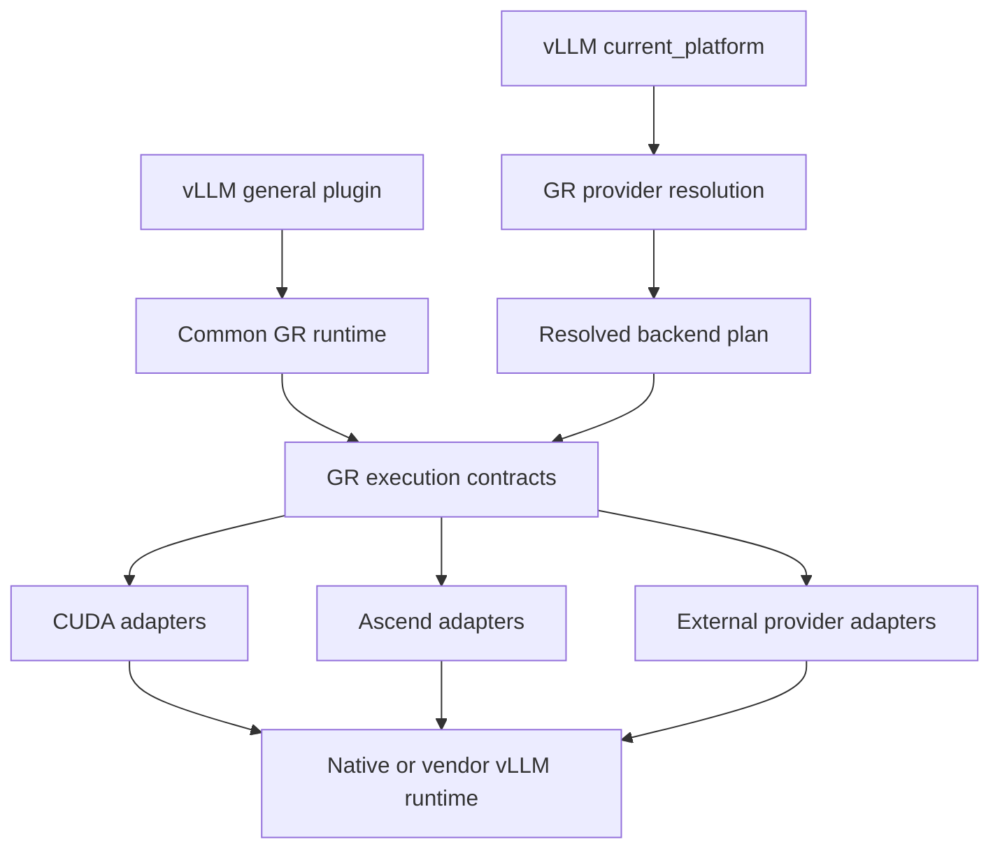
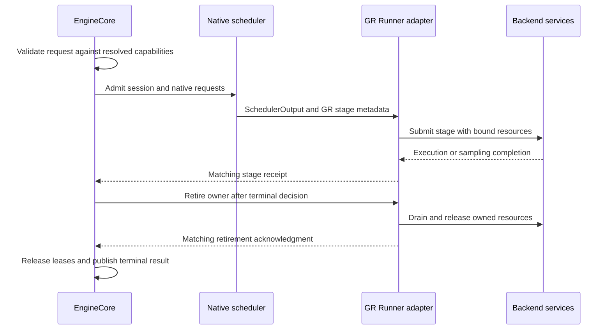

# Multi-hardware backend design

## Decision and scope

Extend the existing GR backend boundary while retaining vLLM platform discovery
and vendor runtimes. vLLM selects the hardware platform; vLLM-GR selects an
implementation of recommendation execution for that platform. Common request,
session, scheduling, scoring, and result semantics remain in GR core.

This is a proposed architecture and migration plan. The interfaces and
configuration additions below are not implemented by this document. CUDA and
Ascend are the first migration targets. ROCm and XPU illustrate future providers;
their presence in this design is not a claim of GR inference support.

The acceptance goal is concrete: adding a third hardware backend requires a
provider package, its adapters, and backend conformance evidence, without adding
hardware-name branches to shared GR scheduling, stage dispatch, or attention
dispatch. A new recommendation algorithm can still require a deliberate change
to the shared protocol.

One process retains one selected hardware backend. Multiple engines using that
backend may have independent configurations and resources within upstream
process-level constraints. Running one model
across heterogeneous GPU/NPU workers, changing platforms in a live process,
expanding supported parallelism, and changing Beam request semantics are outside
this proposal.

## Existing boundaries and gaps

The following observations apply to the source reviewed at
[`fd0184b9`](https://github.com/JiusiServe/vllm-gr/tree/fd0184b9a0183752cf6fdcb6e5df72622f72e115).
The [platform contract](platform_backend_contract.md) describes the current API.

| Boundary | Current implementation | Required change |
| --- | --- | --- |
| Process entry | `plugin.py` registers under `vllm.general_plugins` | Retain upstream loading; make initialization phases explicit |
| Provider discovery | `platforms/loader.py` loads objects from `vllm_gr.platform_backends` | Retain the group and atomic registration; version the provider contract |
| Selection | Registry keys and entry-point names equal `device_type` | Separate backend identity from tensor device type |
| Startup | `_env_check.py` selects checks directly; `patch.py` directly invokes compatibility patches | Route backend-specific checks and hooks through the selected provider |
| Constraint execution | `constraints/startup.py` activates a provider and creates constrained Top-K execution | Preserve the existing execution and scoring contract |
| Runner | `model_runner_patch.py` selects CUDA V1, CUDA V2, or NPU directly | Resolve a runner adapter without losing runner-generation selection |
| Attention | `beam_attn.py` probes availability and selects CUDA, NPU cascade, or NPU xllm | Bind an engine-specific attention adapter with separate Prefill/Decode decisions |
| Stages and graphs | `gr_execution.py`, `gr_startup.py`, and `prefill_graph_runner.py` select device implementations | Bind stage and graph services during runtime construction |

Provider getters currently describe implementations but do not replace the
Runner and Attention dispatchers. Provider activation in the constraint path
does not establish that the general startup path uses provider environment and
patch methods.

The shared layer also contains hardware-shaped details, including FlashAttention
version arguments, NPU metadata/layout branches, and GPU workspace imports.
Moving dispatch alone will not finish the abstraction: these details must move
behind adapters while their logical contracts remain shared.

## Reuse of native vLLM

Use `vllm.general_plugins` to load GR in each participating process. Continue
using native CUDA support and the vendor's `vllm.platform_plugins` package for
Ascend or other out-of-tree hardware. Reuse upstream device initialization,
communicators, model loading, attention registration, and compilation facilities
where the selected backend supports them.

Do not register a second GR platform alongside the vendor platform. Upstream
platform selection chooses one platform and rejects multiple active out-of-tree
platform plugins. A GR backend augments that selection; it does not perform a
second hardware discovery or replace `current_platform`.

The GR provider registry is still necessary because upstream Platform does not
define GR session stages, constrained candidate semantics, or GR graph ownership.
Use public upstream extension points before compatibility patches. Where a patch
is still necessary, keep it version-scoped and owned by a named adapter.



The branches are alternatives. The diagram does not imply heterogeneous execution
inside one engine.

### Alternatives considered

| Option | Assessment |
| --- | --- |
| Use only upstream Platform methods | Reuses discovery, but has no complete contract for GR stages, constraints and graph ownership |
| Build a separate hardware framework | Duplicates platform/runtime responsibilities and increases conflicts with vendor plugins |
| Native platform plus a thin GR provider | Selected: reuse the upstream runtime and define only GR-specific execution boundaries |

The selected option still requires compatibility work when upstream Runner APIs
change. A provider API does not make those private upstream APIs stable; it keeps
their adaptation in one owner instead of spreading it through shared GR code.

## Backend identity and deterministic selection

`device_type` identifies tensor placement, not a unique hardware implementation.
For example, vLLM's `RocmPlatform.device_type` is also `"cuda"`. Resolving every
`"cuda"` device to the NVIDIA provider would select incompatible kernels.

Introduce a distinct `backend_id`, using `cuda` and `ascend` for the initial
providers. Represent the already-selected upstream platform with an immutable,
import-light `PlatformIdentity` containing:

- Upstream platform kind, obtained through its platform enum or predicates.
- Tensor `device_type`.
- Platform class qualified name and relevant class lineage.

Class lineage allows a vendor-specific subclass to be recognized without
importing every vendor runtime. Out-of-tree providers must match an explicit
vendor identity; the generic `OOT` enum or a shared tensor device type is
insufficient. Unknown subclasses are rejected unless explicitly supported.

| Upstream platform | Tensor device type | GR backend ID | Matching requirement |
| --- | --- | --- | --- |
| NVIDIA CUDA | `cuda` | `cuda` | Native CUDA identity; not merely `device_type == "cuda"` |
| Ascend NPU | `npu` | `ascend` | Supported Ascend Platform identity and `npu` placement |
| AMD ROCm | `cuda` | `rocm` | Native ROCm identity; future provider |
| Intel XPU | `xpu` | `xpu` | Native XPU identity; future provider |

Resolution follows this order:

1. Register built-ins and discover external provider objects. Validate all
   descriptors before committing registry changes.
2. Obtain `PlatformIdentity` from vLLM. Never infer selection from installed
   packages or simultaneous `torch.*.is_available()` results.
3. If `backend.id` is explicit, require that provider to match the upstream
   identity. An explicit ID does not switch the vLLM platform.
4. Otherwise require exactly one matching provider. Zero matches is unsupported;
   multiple matches is ambiguous. Do not use discovery order or priority scores.
5. Check provider API compatibility, installed runtime versions, and selected
   feature requirements before exposing the GR engine as ready.

Duplicate backend IDs from different providers are errors, including duplicates
between built-ins and external packages. Installing an external Ascend provider
therefore requires the built-in to be removed or disabled by an explicit,
documented distribution configuration; there is no implicit override.

Third-party IDs should use a vendor prefix when they are not the canonical
implementation. Explicit selection may resolve overlapping platform matches,
but must never suppress duplicate IDs or select an incompatible platform.

## Provider API and runtime ownership

The proposed API version is `2`. Keep a small provider contract and compose
separate execution services instead of introducing a large abstract base class
with dozens of optional callbacks.

```python
from typing import Protocol


class GRBackendProviderV2(Protocol):
    descriptor: "BackendDescriptor"

    def matches(self, platform: "PlatformIdentity") -> bool: ...

    def check_environment(self, context: "ProcessContext") -> "RuntimeReport": ...

    def install_process_hooks(self, context: "ProcessContext") -> "HookReport": ...

    def resolve(self, request: "BackendRequest") -> "BackendPlan": ...

    def create_runtime(
        self, context: "RunnerContext", plan: "BackendPlan"
    ) -> "GRBackendRuntime": ...
```

The quoted types above are proposed contracts, not existing imports. They have
the following responsibilities:

| Contract | Responsibility |
| --- | --- |
| `BackendDescriptor` | API version, backend ID, distribution identity, supported GR/runtime versions, supported upstream platform identities |
| `ProcessContext` | Process role, initialization phase and selected platform; no request or device-buffer ownership |
| `BackendRequest` | Normalized GR/model configuration, native runner request, upstream runtime versions, and requested features |
| `BackendPlan` | Immutable selection of runner adapter, attention paths, graph policy, constraint implementation, and admission limits |
| `RunnerContext` | Actual Runner, assigned device, engine identity, and model/resource generation |
| `GRBackendRuntime` | Runner-owned execution services, readiness validation, invalidation, and idempotent cleanup |

Provider objects hold descriptors and factories only. Registration and matching
must not import Torch, vLLM, vendor modules, kernels, or Runner implementations.
The bridge that reads `current_platform` is the explicit exception: it converts
the upstream object into the import-light identity. Selected-provider runtime
imports occur in environment checks, hook installation, or runtime construction
at the appropriate upstream lifecycle point.

Execution services have narrow responsibilities:

| Service | Contract boundary | Initial implementations |
| --- | --- | --- |
| Runner adapter | Attach to the selected native lifecycle, translate inputs/outputs, preserve native fallback | CUDA V1, CUDA V2, Ascend Runner |
| Stage executor | Execute and sample GR stages; preserve error propagation and retirement acknowledgments | Existing GPU/NPU stage runners |
| Attention execution | Prepare device metadata, write KV, run Prefill/Decode using shared logical Beam metadata | CUDA, Ascend cascade/xllm with separate Prefill handling |
| Graph executor | Validate capture shapes, capture/replay, report actual execution, invalidate and close | CUDA Graph and Ascend ACL Graph adapters |
| Constraint execution | Preserve canonical tokens, scores, validity and resource identity | Existing constrained Top-K implementations |

Runner translation may need both `execute_model` and `sample_tokens`; do not
collapse the native asynchronous lifecycle into a synchronous `run()` call.
Factories receive the same resolved plan so they cannot independently choose
incompatible KV layouts or graph modes.

State ownership is fixed:

- Process: provider registry, selected platform/backend identity, verified hook
  installation records. No process-global per-engine attention-mode cache.
- Engine: normalized configuration, immutable plan and admitted capabilities.
- Runner: model-bound buffers, graph executors, constraint instances, streams,
  events, and workspace. Different runners never share mutable execution state.
- Session: dispatch/generation identities and leases governed by the existing
  session contract. Backend code cannot release native KV independently.

Settings that upstream vLLM treats as process-global remain process-global. If a
second engine requests an incompatible native runner setting or class-patch
variant, reject it with a separate-process requirement rather than mutating the
first engine's behavior.

Prefer composition. Existing `make_patched_*` factories may remain inside the
adapters during migration. Their upstream private method names are not the
external provider API. Do not require all future backends to emulate CUDA V1's
`_prepare_inputs` or `_bookkeeping_sync` methods.

## Capabilities, configuration, and readiness

Capabilities describe valid combinations, not independent feature booleans.
For example, support for an NPU graph mode may depend on xllm execution, dtype,
KV layout, Beam widths, and logical batch size simultaneously.

The plan must capture or validate these dimensions:

- Native runner family/version and upstream interface compatibility.
- Model architecture, dtype, attention geometry, KV dtype/layout and block size.
- Prefill and Decode attention implementations independently.
- Constraint mode, vocabulary slicing, artifact compatibility and Top-K bounds.
- Logical batch sizes, physical row limits, fixed/dynamic Beam schedules,
  candidate widths, stage count and in-flight dispatch depth.
- Graph capture/replay policy, supported shapes and explicit eager fallback.
- Prefix caching, request mixing, chunking, and supported parallel topology.

Keep the current limits for each existing path until separate implementation and
validation expand them. A capability for CUDA V2 must not enable the same feature
on CUDA V1 or Ascend. The CPU selection oracle is not a production CPU backend.

During engine configuration, `resolve()` validates known information and returns
a frozen plan. Workers then validate actual device/kernel availability and
perform allocation and warmup. Each worker reports readiness and a stable plan
fingerprint through startup control flow. The engine starts accepting GR
requests only after all required participants confirm compatible plans.

If a worker cannot satisfy the plan, startup fails. It must not independently
downgrade to another kernel or mode. Automatic choices are made once and recorded;
request-dependent graph/eager routing is permitted only within the resolved
policy. This does not introduce mixed-revision operation: the existing
same-revision deployment contract still applies.

Add an optional `backend` subtree under the existing
`VllmConfig.additional_config["vllm_gr"]` schema. Illustrative proposed input:

```json
{
  "vllm_gr": {
    "backend": {
      "id": "ascend",
      "options": {
        "decode_attention": "xllm"
      }
    }
  }
}
```

`id` defaults to `auto`; the selected provider validates its namespaced options.
Unknown option keys and options belonging to another backend are errors. Common
Beam parameters remain common rather than moving into opaque backend options.

Existing configuration continues to work:

| Existing setting | Migration rule |
| --- | --- |
| `VLLM_USE_V2_MODEL_RUNNER` | Preserve native selection/default policy and resolve the matching adapter |
| `npu_decode_execution` | Normalize into the selected Ascend option; preserve cascade/xllm defaults |
| `prefill_flash_attn_version` | Normalize into CUDA Prefill options; reject incompatible backends |
| Beam and Prefill graph settings/environment variables | Preserve the current path-specific precedence and capture policies |
| Constraint Table backend selector | Normalize as a constraint execution choice and validate against the selected hardware; do not use it for platform discovery |

During the configuration migration, retire hardware-specific enums as the
extensibility mechanism for constraint execution. New providers declare their
supported implementation IDs and option schema; adding one must not require a
new member in a core CUDA/NPU enum. Legacy values remain accepted through explicit
normalization to the existing implementations.

If new and legacy settings explicitly disagree, reject the configuration rather
than choosing silently. Keep `beam.execution_mode="v1"` distinct from native
ModelRunner V1/V2. Parser cache invalidation and GR config serialization must be
updated with the owning configuration contract when these fields are implemented.

## Shared scheduling and backend execution

Keep the existing transport: `BeamBatchRequest`, native `SchedulerOutput` with
GR metadata, and `BeamBatchResult`. `BackendPlan` is startup configuration; it is
not a new per-step wire message or a frontend-driven execution loop.

GR core owns admission, session state, logical stage dependencies, completion,
failure, cancellation, and retirement. Native vLLM scheduling continues to own
prompt accounting, KV blocks and scheduled token counts. Backends consume the
resulting execution view and preserve its identities.

Backend-specific admission rules expose a pure shape/feature validation boundary.
They run before mutating session, native request, or KV state. Shared scheduling
may use declared capacities and restrictions, but does not inspect hardware
names, CUDA streams, or ACL graph objects. A fundamentally different scheduling
algorithm requires a separate scheduler-policy proposal; it must not be hidden
inside a provider callback.



The sequence shows logical dependencies, not a mandatory host synchronization
between every arrow. Preserve asynchronous overlap and current dispatch depth.
Backend completion must not be confused with successful kernel submission.

Common Beam semantics include item/member order, parent indices, global token
IDs, score normalization, structural validity, and terminal-result validation.
Devices may use different fused algorithms and physical representations. Compare
their results using the existing numerical and tie contracts rather than
requiring identical intermediate tensor layouts or arbitrary tied-slot order.

## Graph, attention, and resource lifecycle

Separate logical metadata from device metadata. Common code describes Beam
membership, prefix/suffix extents and parent relationships. The backend produces
its kernel layouts, masks, offsets and buffers. Upstream Attention registration
and backend selection remain in use where available.

Do not force generic attention interfaces to expose FlashAttention version numbers
or a method named `cascade_attention`. Such details belong in CUDA/Ascend adapters.
The first migration may wrap the existing modules; a later interface can expose
Prefill/Decode operations without those implementation-specific arguments.

Graph contracts must cover more than a `capture()` hook:

1. Validate compatible runner, attention implementation, layout and shapes.
2. Allocate persistent inputs, outputs and workspace under Runner ownership.
3. Capture at the lifecycle points permitted by that runner's existing policy.
4. Select a captured shape and update contents without invalidating addresses.
5. Replay, or use a validated eager path when the resolved policy permits it.
6. Drain outstanding work before invalidation, model replacement, or shutdown.

A graph binding includes engine/runner identity, resource generation, resolved
plan fingerprint, model/storage identity and physical layout. Its shape key
includes the stage, logical batch size, physical rows/Beam widths and relevant
prompt/KV bounds. Shape equality alone must not authorize reuse across models,
engines, layouts, or replaced buffers.

Retain the existing capture policies separately: CUDA V1's GR grid and allowed
lazy capture, CUDA V2's native plan and startup replay preparation, and Ascend's
TND/BSND and Decode requirements. In particular, an NPU total-token bucket does
not prove that every member fits its BSND per-request capacity. Prefill and
Decode may intentionally use different kernels under one backend.

Graph misses and execution failures are different. A documented unsupported
capture shape may use an admitted eager path with a reason counter. A kernel
error, corrupt state, or stale binding must propagate and initiate cleanup, not
silently retry on another hardware backend. Partial execution is not safe to
replay as if nothing happened.

Reload and shutdown invalidate model-bound graphs, Attention state, constraint
resources and output buffers before the native operation can replace them.
An in-place weight update may retain a graph only when its adapter explicitly
guarantees storage and captured-state validity and has corresponding tests.
Cleanup is idempotent and also covers failed initialization and failed reload.

## Initialization and compatibility hooks

General-plugin loading can occur before an engine config or device exists.
Split initialization into process bootstrap, engine resolution, and worker
binding instead of reading engine options during module import.

| Phase | Required behavior |
| --- | --- |
| Process bootstrap | Discover descriptors; read upstream platform identity; install only the phase-appropriate, idempotent hooks |
| GR engine configuration | Resolve the backend, environment requirements and normalized feature plan; reject unsupported requests |
| Worker initialization | Validate assigned device and plan, attach the selected runner adapter, allocate/load resources, warm up and report readiness |
| Execution | Call already-bound services; no entry-point discovery, reflection, or backend probing per token |
| Retirement/reload/shutdown | Drain before resource reuse; invalidate relevant bindings and release once |

Preserve non-GR serving on supported runtimes. GR-only feature checks and resources
are activated by GR configuration. A future unsupported GR backend must fail when
GR is requested, not turn an otherwise native request into a CUDA fallback.
Global class wrappers must inspect the owning engine context and delegate normal
requests to the native implementation.

Every frontend, EngineCore and Worker process initializes independently, including
spawn and supported distributed launch paths. Do not rely on inherited Python
registries. Serialize configuration and identities through supported control
paths, never live provider objects, callbacks, streams or graph handles.

Patch ownership is explicit. Move only platform-specific responsibilities behind
the provider. For example, `apply_ascend_attention_backend_patch()` currently also
handles generic CUSTOM Attention selection; split that responsibility before
making the entire function NPU-only. Preserve the delayed NPUWorker import and
initialization ordering needed by Ascend.

Retain patch reports and inventory ownership. Repeated initialization verifies
installed targets rather than blindly stacking wrappers. Registration can be
atomic, but arbitrary Python patch side effects cannot generally be rolled back:
a partial installation failure marks initialization failed and requires a clean
process restart. Update both patch inventory files in each runtime migration PR.

## Package layout and extension contract

Keep the existing `platforms/` public boundary initially; avoid a large file move
in the same change that alters dispatch.

| Proposed location | Content |
| --- | --- |
| `vllm_gr/platforms/identity.py` | Upstream identity bridge and import-light identity records |
| `vllm_gr/platforms/protocol.py` | Versioned provider and service contracts |
| `vllm_gr/platforms/registry.py`, `loader.py` | Discovery, validation, identity matching and deterministic resolution |
| `vllm_gr/platforms/plan.py` | Immutable resolved choices, capability validation and fingerprints |
| `vllm_gr/backends/cuda/` | CUDA provider and V1/V2 adapter composition |
| `vllm_gr/backends/ascend/` | Ascend provider and Attention/Graph/Runner adapter composition |
| Existing `v1/worker/`, `v1/attention/`, `ops/` | Existing implementations wrapped first, moved only in later focused changes |

An external API-v2 package exports a lightweight provider object:

```toml
[project.entry-points."vllm_gr.platform_backends"]
vendor_accel = "vllm_gr_vendor.provider:BACKEND"
```

For API v2, the entry-point name equals `descriptor.backend_id`. Core validates
descriptor shape and API compatibility before activation. The provider declares
supported GR and upstream runtime versions; kernel/driver validation occurs in
the selected environment. Expose installation origin and versions in diagnostics.

For one migration release, a narrow compatibility adapter may accept the current
unversioned CUDA/NPU provider objects as API v1. Map legacy `cuda` to NVIDIA CUDA
and `npu` to Ascend explicitly, with strict upstream identity matching. Preserve
legacy lookups only through that adapter and emit a deprecation notice. Do not
infer API-v2 capabilities from the presence of old getter methods. Arbitrary
third-party API-v1 device keys require an explicit identity upgrade.

Keep vendor dependencies optional to core. A CUDA install must not import or
install the Ascend runtime. Share Python interfaces and semantic resources across
packages; do not promise that conflicting vendor Torch/Triton/NumPy stacks can
coexist in one environment. Backend wheels/images declare their supported stack.

The built-in Ascend implementation can move to a separate distribution after
contract and runtime conformance are established. Package extraction is optional
and does not determine whether the architecture supports external backends.

### Adding a third backend

1. Provide a working native/vendor vLLM platform runtime independently of GR.
2. Implement a lightweight API-v2 descriptor with a unique backend ID and strict
   platform matching; register its provider object in the existing entry-point group.
3. Implement the selected runner/stage, attention, constraint and graph services.
   Advertise only supported combinations; graph support is optional when the
   declared eager execution path satisfies the requested GR contract.
4. Package vendor dependencies and option validation with that backend. Install
   it alongside core in the matching runtime environment.
5. Run external-provider conformance, lifecycle, real-device correctness, accuracy
   and performance checks before documenting production support.

No change to common scheduling or device-name dispatch is required. A hardware
platform that lacks a necessary semantic operation must reject that GR mode or
propose a shared contract extension, rather than silently changing its meaning.

## Migration plan

Each stage is independently reviewable and preserves existing behavior except
for the explicit selection errors introduced by the new contract.

| Stage | Main files and responsibilities | Exit condition |
| --- | --- | --- |
| 1. Identity and API | `platforms/`, current provider tests, configuration parser | CUDA/ROCm collision prevented; duplicate/ambiguous providers fail; import isolation and legacy mapping verified |
| 2. Bootstrap | `plugin.py`, `_env_check.py`, `patch.py`, `ascend_compat.py` | Environment and hook ownership wired through providers; generic CUSTOM behavior preserved; all process roles covered |
| 3. Runner and stages | `model_runner_patch.py`, `gr_execution.py`, GPU V1/V2 and NPU adapters | Shared dispatch calls bound services; native execute/sample ordering and retirement remain correct |
| 4. Attention and constraints | `beam_attn.py`, metadata builders, `constraints/startup.py` | Prefill/Decode selections and KV layouts are coherent; cascade/xllm and constraint semantics preserved |
| 5. Graph lifecycle | `gr_startup.py`, `prefill_graph_runner.py`, Decode/Prefill graph implementations | Replay, fallback, model reload and resource ownership pass each path's tests |
| 6. External conformance | Provider packaging, docs, an out-of-tree test provider | Third provider integrates without hardware branches in shared execution; optional Ascend extraction can proceed |

Update owning contracts, examples and `docs/runtime_patch_inventory.md` plus
`docs/patch_inventory.yaml` alongside every change to actual patch behavior.
Keep this proposal separate from descriptions of already-supported features.

Existing factories can delegate into the new services during migration. Avoid
keeping two independent selection policies. Roll back a failed migration stage
as a deployment/release unit; do not switch provider objects in a live process.

## Validation and acceptance

Use [validation levels](tools/README.md#validation-levels). Mock providers prove
interface routing, not accelerator execution. The out-of-tree test provider is
host-only and must not be advertised as a production CPU backend.

| Coverage | Required evidence |
| --- | --- |
| Identity and registration | NVIDIA/ROCm shared device type, unknown OOT identity, ambiguous matches, duplicate sources, explicit incompatible selection and API-version failures |
| Import and packaging | Core/built-ins/external descriptors import without vendor runtimes; unselected dependencies remain unloaded; installed wheel discovery works outside the checkout |
| Process lifecycle | Fresh spawn initializes independently; repeated initialization does not stack hooks; unsupported GR fails explicitly; ordinary supported serving retains native behavior |
| Per-engine isolation | Two engines on one platform use distinct options/resources; no process-global attention mode, graph buffers or constraint state leaks |
| Execution semantics | Candidate validity, global token IDs, cumulative scores, parent/member order, ties and no-valid-candidate behavior match existing contracts |
| Scheduling | Cache hit/miss, cancellation, prepare/execute/sample failures, stale receipts, retirement and retry preserve leases and generation checks |
| Hardware paths | CUDA V1/V2 and Ascend cascade/xllm, each with its admitted eager/graph modes and feature combinations |
| Graph lifecycle | Actual replay counters, stable bindings, batch/width transitions, shape misses, in-flight cleanup and failed reload; enabling a flag alone is insufficient |
| Performance and accuracy | Same model, inputs, runtime and path-specific baseline; accepted benchmark policy, accuracy and replay evidence reported separately |

Extend existing suites under `tests/platforms/`, `tests/contract/`,
`tests/constraints/`, `tests/v1/worker/`, `tests/kernels/`, and `tests/st/`.
Add a host-only external provider fixture that exercises the normal loader and
services without changing the central dispatcher. Inspect fixtures before
selecting tests; directory names do not establish hardware requirements.

The migration is complete when:

1. Shared scheduling and execution dispatch contain no backend-name switches;
   hardware matching is confined to provider resolution and backend packages.
2. Every production execution path uses the selected plan and owned services.
3. CUDA V1/V2 and Ascend retain their validated functionality and performance
   acceptance, including graph replay and resource retirement.
4. A third external provider can pass interface conformance without modifying
   shared dispatch. Production support additionally requires real-device evidence.
5. Diagnostics report backend/provider versions, runner and attention choices,
   graph policy, initialization failures, and eager fallback reasons without
   adding discovery or device synchronization to the per-token hot path.

## References

- [Current platform backend contract](platform_backend_contract.md)
- [Beam request, scheduling and retirement contract](beam_batch_execution_contract.md)
- [Asynchronous scheduling](async_scheduling.md)
- [CUDA Prefill capture](prefill_graph_capture.md)
- [CUDA ModelRunner V2](modelrunner_v2_multibatch.md)
- [Ascend BSND Prefill](npu_prefill_bsnd.md)
- [vLLM 0.30 plugin system](https://docs.vllm.ai/en/v0.30.0/design/plugin_system/)
- [vLLM 0.30 platform resolution](https://github.com/vllm-project/vllm/blob/v0.30.0/vllm/platforms/__init__.py)
- [ROCm tensor device type](https://github.com/vllm-project/vllm/blob/v0.30.0/vllm/platforms/rocm.py#L488)
