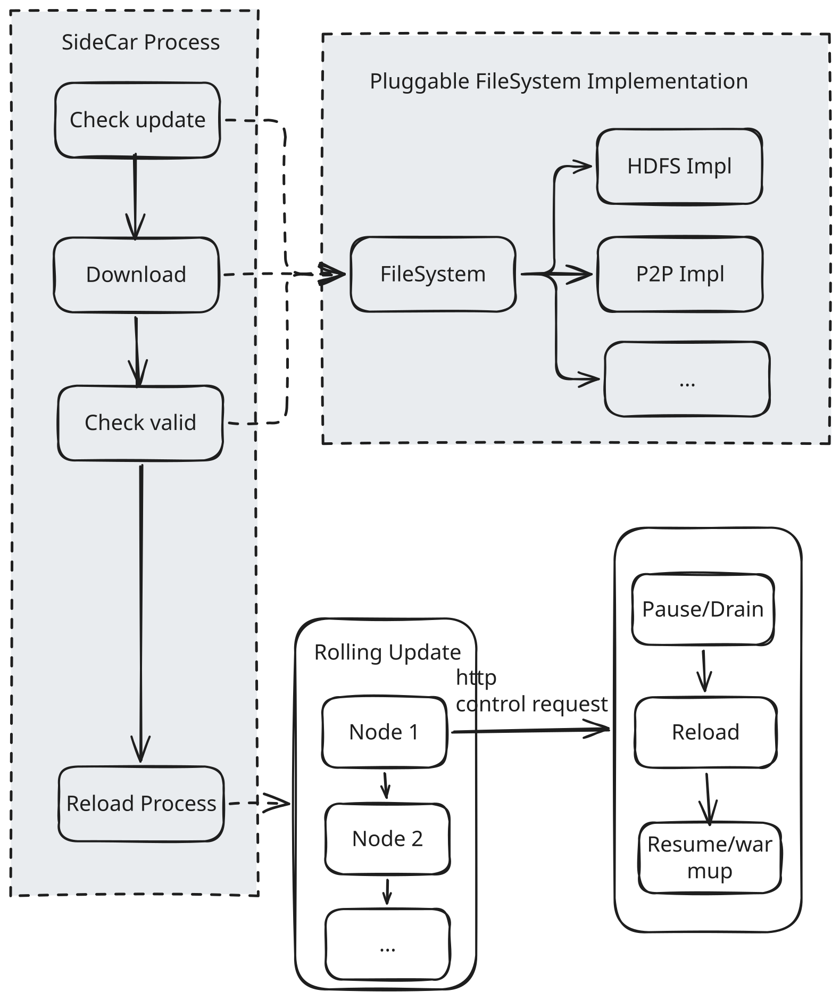

# Weight update sidecar design

## Scope

Add a sidecar process that discovers and downloads checkpoints, then rolls out
weight updates across the GR service instances in one Pod. Only weights change:
model architecture, tokenizer, configuration, and Trie resources remain unchanged.
This document proposes the implementation; it does not introduce runtime code.

The Pod commonly has eight independent, single-GPU services, but the instance list
is configurable. An instance can also own multiple workers; its reload must succeed
on every worker. GPU count alone must not be used to infer service endpoints.

## Data and control flow

The sidecar owns the outer update loop. It prepares a checkpoint before sending
HTTP control requests to the GR service instances. Storage access is provided by
pluggable `FileSystem` implementations: HDFS first, with P2P and others added later.



The flow follows the stages shown above:

1. **Check update:** discover a newly published checkpoint through `FileSystem`.
   If no update is available, wait for the next poll.
2. **Download:** fetch the checkpoint once into a temporary directory on the Pod's
   shared volume. No service instance is paused during the download.
3. **Check valid:** verify the downloaded files against the manifest, including
   completeness, sizes, checksums, and compatibility with the running model. Only
   a valid checkpoint is published as an immutable local directory for rollout.
4. **Reload Process:** roll out the local checkpoint to Node 1, Node 2, and the
   remaining configured instances using HTTP control requests. For each instance,
   execute **Pause/Drain -> Reload -> Resume/Warmup** in that order.

`Node` in the diagram means one GR service instance, not a physical host. `N` is
its total configured count (commonly 8). Update at most `n` instances in each
rolling group, controlled by `max_concurrent_updates` (default 1, range 1 to N).
Finish the
current group before starting the next; instances outside the group keep serving.

Within each instance, Pause/Drain closes business admission and waits for accepted
requests to finish. Reload loads the checkpoint on every worker and refreshes
weight-dependent state internally. Resume/Warmup first resumes scheduling, then
executes warmup requests while business admission stays closed. Only a successful
warmup publishes the serving version and reopens admission. The diagram groups
Resume/Warmup as one phase; the control API exposes resume and warmup separately.

An update slot covers the entire instance lifecycle, including recovery. Failed
instances retain their slots until recovery succeeds. Rolling updates temporarily
serve different weight versions; cross-instance atomic switching is outside scope.

## Sidecar responsibilities

### Check update, download, and check valid

Keep discovery and download behind a small `FileSystem` interface. The controller
then runs a common local validation step, so HDFS, P2P, and future implementations
share the same checkpoint validity rules:

```python
class FileSystem(Protocol):
    async def get_latest_version(self, address: str) -> CheckpointRef | None: ...
    async def download(self, address: str, staging_dir: Path) -> None: ...
```

`CheckpointRef` contains a stable version, immutable source URI, manifest digest,
and expected files with sizes and checksums. The first implementation is
`HDFSDownloader`, implementing `FileSystem` with the deployed HDFS client. P2P and
other storage implementations can be added later. All implementations
reuse the same rollout logic without changing service APIs.

The publisher uploads checkpoint files first and publishes the manifest last.
Discovery only returns published versions; directory modification time is not a
completion signal. This publication convention is a deployment prerequisite.

The sidecar downloads once into a shared volume visible at the same path to all
instances. The Check valid stage checks completeness, checksums, and model
compatibility before the controller atomically renames the
temporary directory to a versioned directory on the same filesystem. Published
directories are immutable. Failed downloads never trigger pause. Keep the current
and previous checkpoint until all instances finish and retention permits cleanup.
Storage credentials belong to the FileSystem deployment, not service requests.

### Reload Process and rolling update

After Check valid succeeds, enter Reload Process. Configure explicit instance IDs
and HTTP control endpoints for Node 1 through Node N. Persist each instance's
target version, last verified serving version, operation ID, phase, and error in
the shared volume. Query server state after a sidecar restart instead of blindly
repeating calls. Allow only one rollout coordinator per Pod.

Serialize checkpoint rollouts. If another version appears during a rollout, finish
the current rollout before selecting the newest published version. Do not compare
version strings to infer ordering; use the publication manifest's ordering.

On an update failure, stop starting new instance updates. Already running updates
must finish or enter a known failed state. A failed instance continues occupying
its update slot until recovered: `n` bounds unavailable instances as well as active
update tasks. Do not automatically proceed and make more instances unavailable.

## Server control contract

Use HTTP control endpoints independently of the inference protocol. HTTP serving
already inherits upstream pause/resume routes. A gRPC-only deployment needs a
separate control listener exposing the same operations. These endpoints are for
the sidecar on the Pod control network and must not expose generic worker RPCs.

The endpoint names below are proposed; existing pause/resume behavior is extended
only where needed for maintenance admission and operation tracking.

| Operation | Contract | Existing capability and required work |
| --- | --- | --- |
| `POST /pause?mode=wait` | Close business admission, drain accepted work, return only when reload is safe | Upstream pause/drain exists with multiprocess Engine Core; add maintenance admission and timeout handling. In-process mode needs a drain implementation before being supported. |
| `POST /reload_weights` | Load a local checkpoint on every worker and maintain all weight-dependent resources | Internal worker reload exists; add the public handler, validation, lifecycle integration, and operation state. |
| `POST /resume` | Resume scheduling while maintenance admission remains closed | Reuse upstream resume; distinguish scheduler state from business readiness. |
| `POST /warmup` | Execute configured real GR requests, validate completion, then reopen admission | Add the endpoint and controlled internal admission for warmup requests. |
| `GET /weight_update/status` | Report phase, operation ID, target/loaded/serving versions, readiness, and last error | Add a query API for reconciliation and timeout recovery. |

While maintenance admission is closed, new business requests receive an explicit
unavailable response rather than queueing behind pause. Requests accepted before
the gate closes must either drain or receive a terminal failure before reload.
Warmup uses an internal admission path, not a caller-supplied public bypass flag.
Liveness stays healthy during an update; readiness stays false until warmup passes.

Example reload body:

```json
{
  "operation_id": "rollout-42-instance-0",
  "version": "checkpoint-42",
  "weights_path": "/checkpoints/checkpoint-42",
  "manifest_digest": "sha256:..."
}
```

Only allow paths under the configured checkpoint root. Verify the local manifest,
compatible parameter names/shapes/dtypes, and checkpoint completeness as far as
possible before mutation. Native loader warnings alone are not a successful
validation. Model structure and non-weight configuration must match startup.

Reload requires a drained, paused instance and an exclusive update lock. Dispatch
`reload_weights(weights_path=...)` through the engine to every worker; return
success only after all workers acknowledge and device work completes. Repeated
calls with the same operation ID and payload return the existing result; conflicting
payloads or overlapping updates are rejected. Other maintenance operations also
carry the operation ID so retries cannot resume the wrong update.

### Reload owns derived weight state

Cache maintenance is an internal part of reload, not an extra sidecar call.
The current sliced LM-head path clones weight/bias slices and keys reuse by
vocabulary range, so updating the original parameter alone can leave stale logits
weights. Refresh these copies and audit other derived layouts. NPU stage logits
already have reload hooks; integrate and test their success/failure behavior.

CUDA Graph references must remain valid. Update derived buffers in place where
addresses can be preserved. If loading or postprocessing changes required storage,
invalidate and rebuild the affected execution resources before reporting success.
Do not unconditionally repeat the startup compilation routine on a live worker.

### Warmup and version publication

Configure warmup inputs at deployment time, including representative prompt length,
batch size, beam width, and decode steps. Use the actual GR engine execution path;
check successful completion, expected result shape, and finite scores. Warmup does
not prove model quality, but verifies the updated instance can execute its workload.

After reload, report `loaded_version=new` but retain the previous verified
`serving_version`. After successful warmup, atomically publish the new serving
version and reopen admission. A warmup failure keeps the instance unavailable.

## Failure and recovery

| Failure | Required behavior |
| --- | --- |
| Discovery/download/validation fails | Keep all instances serving; retry without pausing. |
| Drain times out | Do not reload. Reconcile state and resume the unchanged instance if safe; halt rollout. |
| Reload fails on any worker | Keep admission closed; partial parameter mutation is possible. Halt rollout. |
| Warmup fails | Keep admission closed and halt rollout; do not publish the target serving version. |
| Client call times out | Query operation status; timeout does not mean server execution stopped. |
| Sidecar restarts | Recover persisted rollout state and reconcile each server before acquiring more slots. |

For reload/warmup failure, explicitly reload the retained previous checkpoint on
all workers, then resume and warmup before reopening admission. If restoration
cannot be verified, keep the instance unavailable and restart it with the previous
checkpoint. This is a recovery reload, not an assumed atomic rollback. Recovery
uses the same update slot. Make recovery outcome visible in status and logs.

## Configuration and pseudocode

```yaml
watch_uri: hdfs://cluster/models/gr/published
poll_interval_seconds: 30
filesystem: hdfs
checkpoint_root: /checkpoints
max_concurrent_updates: 1
instances:
  - id: gpu-0
    control_url: http://127.0.0.1:9100
  - id: gpu-1
    control_url: http://127.0.0.1:9101
# Configure all service instances; eight is a deployment choice.
# Also configure download/drain/reload/warmup timeouts and warmup inputs.
```

```python
async def reload_instance(instance, checkpoint, operation_id):
    # Slot remains reserved until success or verified recovery.
    await instance.pause(operation_id, mode="wait")
    await instance.reload_weights(operation_id, checkpoint.local_path,
                                  checkpoint.version, checkpoint.manifest_digest)
    await instance.resume(operation_id)  # Business admission remains closed.
    await instance.warmup(operation_id)  # Opens admission only on success.


async def reconcile():
    await recover_rollout_state()
    while True:
        checkpoint = await filesystem.discover(config.watch_uri)  # Check update
        if checkpoint is not None and needs_rollout(checkpoint):
            staging = await download_to_staging(filesystem, checkpoint)  # Download
            await check_model_valid(staging, checkpoint)  # Check valid
            local = await publish_checkpoint(staging, checkpoint)
            # Reload Process: each group calls reload_instance for up to n nodes.
            await rollout_in_groups(local, config.max_concurrent_updates)
        await wait_for_next_poll()
```

## Implementation and acceptance

Proposed code organization:

```text
vllm_gr/
  sidecar/
    __main__.py             # Separate process entry point and configuration
    controller.py           # Discovery loop, bounded rollout, reconciliation
    state.py                # Persistent rollout and per-instance progress
    client.py               # Typed server control client
    filesystems/
      base.py               # CheckpointRef and FileSystem contract
      hdfs.py               # HDFS discovery and download implementation
  entrypoints/
    weight_update.py        # HTTP control handlers and maintenance admission
  v1/
    engine/                 # Draining and collective reload integration
    worker/                 # Reload resource lifecycle integration
```

Reuse upstream pause/resume and worker loading rather than copying them. Integrate
with existing GR execution-resource owners; do not add a second model loader.

Required tests:

- FileSystem: incomplete publication, corrupt/missing files, interrupted download,
  atomic publication, and safe retry; run an HDFS integration smoke separately.
- Controller: configurable instance count, maximum unavailable count of `n`, strict
  per-instance ordering, duplicate versions, failure stop, and restart reconciliation.
- Control API: drain semantics, business admission, idempotency, invalid paths,
  competing updates, timeouts, and all-worker failure propagation.
- GPU end to end: load distinguishable same-structure checkpoints A/B; verify B
  output against a fresh B instance, including sliced logits and supported Graph
  paths. Inject reload/warmup failures and verify no traffic reaches partial state.
- Performance: compare steady-state inference before and after lifecycle changes
  with identical weights/settings; separately report drain, reload, warmup, and
  total per-instance unavailability. Include V1/V2 and NPU where supported.

Deployment details to confirm before implementation: checkpoint publication
manifest format, HDFS client/authentication, instance control endpoints, routing
behavior during readiness changes, and representative warmup inputs. The design
defaults to fail-stop rollout and verified restoration of the previous checkpoint.
