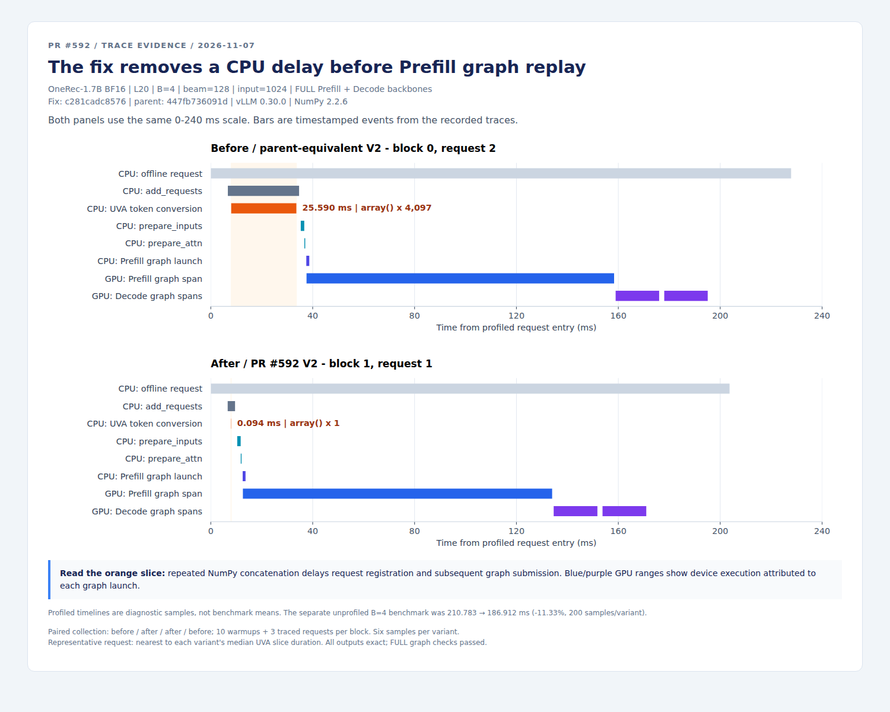
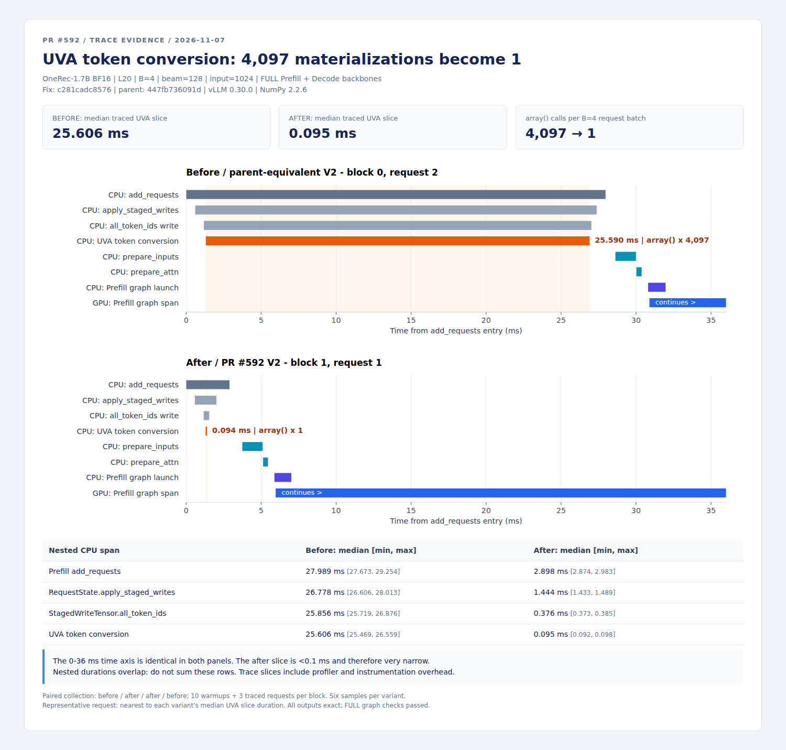

# PR #592: B=4 UVA staging trace evidence

Captured on 2026-11-07 for [PR #592](https://github.com/JiusiServe/vllm-gr/pull/592).

The orange CPU interval shows the repeated NumPy materialization that this PR
removes. The diagrams are rendered from timestamped Chrome trace events;
they are not a simulated timeline or screenshots of the Perfetto interface.

## Images

Both before/after panels use identical time scales. The overview aligns each
request at entry; the detail aligns each Prefill `add_requests` call at entry.
The request selected for each variant is nearest to its median UVA slice
duration, using all six samples. Nested CPU durations overlap and must not be
summed. GPU graph bars are device ranges correlated to graph launch annotations.

## Revisions and collection

- Fixed checkout: `c281cadc8576d28fc3ccf2000c22a250e3bac216`.
- Parent runtime: `447fb736091d6f70681bd17b9f321423c33c8cfd`.
- The before control removes only `NumpyStagedContents.__array__` inside the
  test process; the after control restores the checked-out implementation.
  The parent equivalence was verified during the isolated validation recorded
  in the PR description. No checkout source files were edited for this capture.
- OneRec-1.7B BF16, NVIDIA L20, B=4, beam width 128, input length 1024 including
  SID begin, three generated SID stages, Prefix Cache disabled, FULL Prefill
  and Decode backbones. The existing fixed inputs and repository E2E timer
  were reused, through the checkout's `.venv` environment.
- One engine, before/after/after/before order. Each block has ten warmups and
  three profiled requests, giving six samples per variant. Profiling uses
  CPU and CUDA activities; stack, shape, and memory recording are disabled.
- Diagnostic wrappers add ranges around the native staging functions and
  count `array()` invocations. These wrappers are present in both variants.
- All token IDs, scores and output text match between variants and the prior
  isolated validation. Graph checks pass: FULL Prefill dispatch, no request-time
  capture or eager Decode, stable graph registrations, and clean request state.

## Results

| CPU span | Before median (ms) | After median (ms) |
| --- | ---: | ---: |
| Prefill `add_requests` | 27.989 | 2.898 |
| `RequestState.apply_staged_writes` | 26.778 | 1.444 |
| `StagedWriteTensor.all_token_ids` | 25.856 | 0.376 |
| UVA token conversion | 25.606 | 0.095 |

Every before request performs 4097 materializations; every after request
performs one. These are profiled durations, including instrumentation overhead.
The independent unprofiled B=4 benchmark in the PR description measured
210.783 to 186.912 ms, an 11.33% latency reduction over 200 samples per variant.

## Trace files

| Block | Variant | File | Requests |
| --- | --- | --- | ---: |
| 0 | Before | [00_before.pt.trace.json.gz](00_before.pt.trace.json.gz) | 3 |
| 1 | After | [01_after.pt.trace.json.gz](01_after.pt.trace.json.gz) | 3 |
| 2 | After | [02_after.pt.trace.json.gz](02_after.pt.trace.json.gz) | 3 |
| 3 | Before | [03_before.pt.trace.json.gz](03_before.pt.trace.json.gz) | 3 |

Files are byte-for-byte copies of the original profiler output, renamed by
the recorded experiment block. The profiler retained its first filename
prefix across start/stop calls; the variants above come from the collection
manifest and verified per-request materialization counts.

Decompress a file and open the JSON in a local Chrome trace-compatible viewer.
Find `ROOTCAUSE::UVA_copy_NumpyStagedContents` for the affected range,
`ROOTCAUSE::V2.add_requests` for the enclosing Prefill registration, and
`PR592::Prefill_FULL_graph_launch` for host launch and correlated GPU activity.
The original event timestamps and durations are unchanged.

`trace_summary.json` contains all 12 requests, selected CPU/GPU slices, sample
selection, statistics and SHA-256 hashes of the four trace files.
`provenance.json` records revisions, environment, input hash and source hashes.

To regenerate the SVG figures and local HTML reports, run
`python render_figures.py` with Matplotlib installed. Open `overview.html` or
`detail.html` locally. The PNG files are Chromium screenshots of those reports.

These files are review evidence on a separate branch. They do not change the
runtime implementation or the source branch of PR #592.
